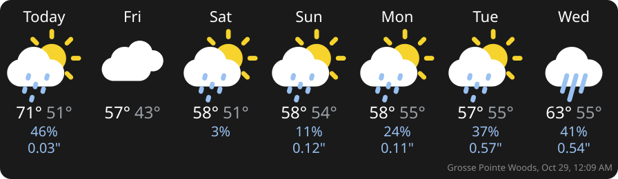

# hubitat-weather-tile

A standalone Hubitat Elevation app that shows a multi-day weather forecast strip on Hubitat dashboards. It is modelled on the forecast strip in [Rachio-Community](https://github.com/lnjustin/Rachio-Community), without any irrigation dependency, and with a choice of weather sources and display options.

The app serves the forecast as an SVG image from its own OAuth endpoint. The dashboard tile is a short `` attribute (about 220 characters), well under Hubitat's 1,024-character limit. The forecast is fetched on a schedule and cached; viewing the dashboard never triggers a weather API call.

**Status:** 0.2.4. Built without being installed on a hub yet; see [Known limitations](#known-limitations). Requirements: [REQUIREMENTS.md](REQUIREMENTS.md).

## Pieces
| File | Type | Purpose |
|---|---|---|
| `libraries/cummingsrob.WeatherTileIcons.groovy` | Library | Default icon pack (Rob's colored set). |
| `libraries/cummingsrob.WeatherTileIconsOutline.groovy` | Library | Outline icon pack. |
| `apps/WeatherTileManager.groovy` | App (parent) | Holds your weather tiles. Install once. |
| `apps/WeatherTileInstance.groovy` | App (child, **OAuth**) | One tile: settings, fetching, SVG endpoint. `#include`s the icon library. |
| `drivers/WeatherTileDevice.groovy` | Driver | The device each tile creates; put it on a dashboard. |
| `bundle.zip` | Bundle | All of the above, for **Bundles → Import ZIP**. |
| `bundle-library.zip` | Bundle | Libraries only (used by HPM). |

No external libraries; only built-in Hubitat APIs. The library must be on the hub before the instance app is saved.

## Install option A: Hubitat Package Manager (recommended)
HPM → **Install** → **From a URL** → `https://raw.githubusercontent.com/cummingsrob/hubitat-weather-tile/main/packageManifest.json`. HPM installs the library bundle, the driver and both apps, and enables OAuth for the instance app. Then go to step 5 below. (Not yet submitted to the HPM master list.)

## Install option B: bundle
1. **Developer tools → Bundles → Import ZIP** → URL `https://raw.githubusercontent.com/cummingsrob/hubitat-weather-tile/main/bundle.zip` (or download and upload it). This installs the library, driver and both apps.
2. **Apps Code → Weather Tile Instance** → **OAuth** → **Enable OAuth in App** → **Update** → **Save**. (Bundles do not enable OAuth.)
3. Continue at step 5 below.

## Install option C: manual, one file at a time
1. **Libraries Code** → **+ New Library** → **Import** → `https://raw.githubusercontent.com/cummingsrob/hubitat-weather-tile/main/libraries/cummingsrob.WeatherTileIcons.groovy` → **Save**. Repeat for `.../libraries/cummingsrob.WeatherTileIconsOutline.groovy`.
2. **Drivers Code** → **+ New Driver** → **Import** → `.../drivers/WeatherTileDevice.groovy` → **Save**.
3. **Apps Code** → **+ New App** → **Import** → `.../apps/WeatherTileManager.groovy` → **Save**.
4. **Apps Code** → **+ New App** → **Import** → `.../apps/WeatherTileInstance.groovy` → **Save** → **OAuth** → **Enable OAuth in App** → **Update** → **Save**.

(`...` = `https://raw.githubusercontent.com/cummingsrob/hubitat-weather-tile/main`)

## Then (all options)
5. **Apps** → **+ Add User App** → **Weather Tile Manager** → **Done**.
6. Open **Weather Tile Manager** → **Add a weather tile** → choose settings → **Done**. A device with the tile's name is created.
7. On a dashboard, add a tile: device = that device, template = **Attribute**, attribute = **weatherTile**.

## Adding an icon pack (developers)
Create a new library (for example `cummingsrob.WeatherTileIconsMeteocons`) with a provider method returning `[packId: [label: "...", icons: [sunny: '<g>...</g>', ...]]]`, drawn in a 64x64 box using the CSS classes `cloud`, `light`, `precip`, `frozenPrecip`. Add `#include` for it in `WeatherTileInstance.groovy`, add the method name to `WT_ICON_PACK_PROVIDERS`, add the library to `LIBS` in `tools/build.py`, and run `python3 tools/build.py` to rebuild the bundles. Missing icon keys fall back (see `CONDITIONS`).

## Settings (per tile)
- **Source:** Open-Meteo (default, global, no key), NWS/weather.gov (US only, no key), or a keyed provider (API base URL + key; OpenWeatherMap One Call 3.0 `daily` format).
- **Refresh interval:** 15 min, 30 min (default), 1 h, 3 h. Errors back off exponentially (up to 6 h; at least 1 h after HTTP 429) and keep the last good forecast, marked "(stale)".
- **Location:** hub latitude/longitude by default; optional custom lat/lon and label.
- **Units:** follow hub (default), imperial, or metric.
- **Days:** 1-7 (default 7: today + 6).
- **Theme:** dark background with light icons (default) or light. Optional transparent background, corner radius, font family, font size, and per-color overrides.
- **Icon pack:** Rob's colored set (default) or outline.
- **Show/hide:** high/low, rain %, rain amount, hide zero values, day-label style.
- **Last updated:** tiny line, default `'Updated' MMM d, h:mm a` → "Updated Oct 28, 5:40 PM" (hub time zone).
- **Tile URL:** local (LAN) or cloud (remote dashboards).
- Buttons: **Refresh forecast now**, **Regenerate access token** (updates the tile attribute).

## Device attributes
`weatherTile`, `lastUpdated` (ISO 8601), `lastUpdatedDisplay`, `source`, `status` (ok/stale/error), `statusMessage`, `units`, `latitude`, `longitude`, `locationLabel`, `todayHigh`, `todayLow`, `todayPrecipChance`, `tomorrowPrecipChance`, and per day n=0..6: `day{n}Date`, `day{n}Label`, `day{n}High`, `day{n}Low`, `day{n}Condition`, `day{n}ConditionText`, `day{n}Icon`, `day{n}PrecipChance`, `day{n}PrecipAmount`. Events are sent only on change. The device's **Refresh** command fetches immediately.

Debug: `<tile URL base>/forecast.json?access_token=...` returns the cached forecast.

## Known limitations
- Not yet run on a real hub. Verified only by compiling with Groovy 2.4 and a local harness that stubs Hubitat APIs and calls the real Open-Meteo and NWS APIs.
- NWS has no daily precipitation amount, and after about 6 PM "today" has only an overnight low.
- The keyed provider only understands the OpenWeatherMap One Call `daily` format. Tomorrow.io and others need their own normalizer.
- The rendered SVG is cached in memory and rebuilt from saved forecast data after a hub reboot.
- Extra fields (current conditions, wind, humidity, sunrise/sunset, alerts) are not implemented yet (v2).
- Bundle import and HPM library install are untested on a hub. HPM only tracks the library through the bundle; updating the library means rebuilding the zips (`python3 tools/build.py`).
- Animated icon packs (Meteocons and others) are not included.

## Credits and licenses
- Code: Apache-2.0 ([LICENSE](LICENSE), [NOTICE](NOTICE)). Portions adapted from Rachio-Community, © 2018 Anthony Santilli, © 2024 lnjustin, Apache-2.0.
- Icons: derived from [erikflowers/weather-icons](https://github.com/erikflowers/weather-icons); the filled set is Rob Cummings' color-modified version. SIL OFL 1.1 ([ICONS-LICENSE.txt](ICONS-LICENSE.txt)).
- Weather data: [Open-Meteo](https://open-meteo.com) (CC BY 4.0) and the US National Weather Service.
